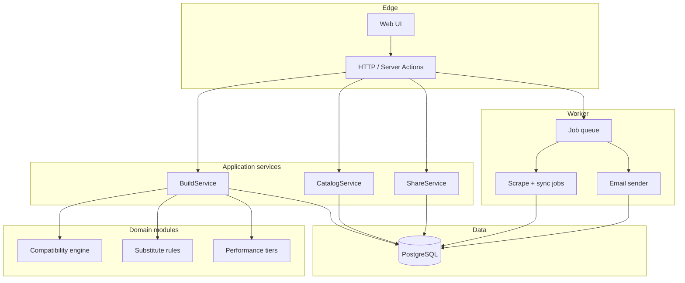
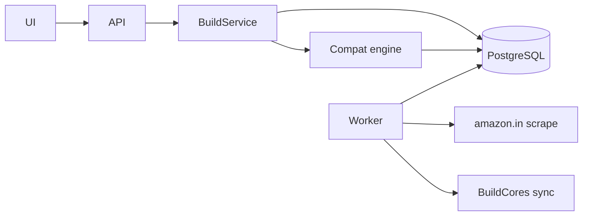
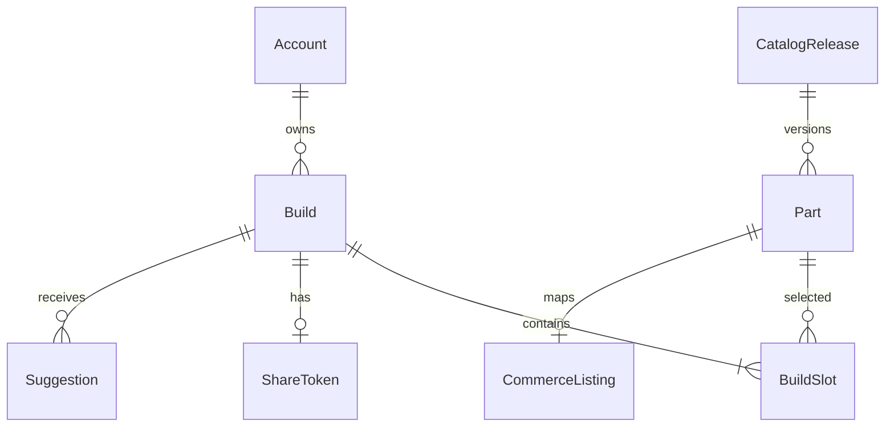

# Architecture Spine — PC Part Picker & Builder (v1)

## Design Paradigm

**Modular monolith:** one **web/API** deployable and one **worker** deployable share PostgreSQL and a Redis-backed job queue. Domain logic lives in modules (`catalog`, `build`, `compatibility`, `commerce`, `identity`, `notifications`, `social`, `performance`, `ops`); UI and route handlers sit at the edge and call application services only.



**Dependency rule:** `compatibility`, `substitute` rules, and `performance` tables do not import HTTP, UI, or job infrastructure. Workers call the same application services or domain modules the API uses—never a parallel code path for compat.

## Invariants & Rules

### AD-1 — Single system of record

- **Binds:** all
- **Prevents:** Two teams picking different databases or caching writable build state in Redis.
- **Rule:** All durable state (catalog, builds, accounts, share tokens, scrape capture metadata, email outbox) lives in **PostgreSQL**. Redis is queue/cache only—not authoritative for builds or catalog.

### AD-2 — Server-owned compatibility

- **Binds:** CAP-5, FR-11, FR-13
- **Prevents:** Browser-only compat that diverges from save/share/complete gates.
- **Rule:** The **compatibility engine** is a pure domain module. Run it on **every Build mutation** and when opening any **saved or shared** Build. Clients render results; they do not decide Invalid vs Warning. **Warning vs Invalid** severities come only from the versioned rules registry for the active catalog release—no duplicate severity logic in UI or routes.

### AD-3 — Build mutation gate

- **Binds:** CAP-4, CAP-9, CAP-10
- **Prevents:** Invalid Builds saved, shared, or marked Complete.
- **Rule:** **BuildService** is the only write path for Build state. **Invalid** blocks save, share-link creation, and **Complete**; **Warning** allows save/share with warnings attached. No route or UI flag bypasses this.

### AD-4 — Catalog: spec vs commerce

- **Binds:** CAP-11, FR-25–FR-27, `catalog-sources.md`
- **Prevents:** Scrape jobs overwriting BuildCores spec fields or deploying compat rules without a catalog release id.
- **Rule:** **Spec ingest** (BuildCores snapshot/sync, curation, year filter, ≤30/Slot) is separate from **commerce ingest** (amazon.in scrape for mapped ASINs). Compatibility rule sets are **versioned** and tied to a **catalog release**; weekly spec reconcile; critical errata target ≤72h. **Evaluation always uses the current active `catalogReleaseId`** (and its rule set) on mutation and on open—not a frozen release on `ShareToken` or at first save.

### AD-5 — Staleness and incidents

- **Binds:** `catalog-freshness.md`, CAP-2, CAP-12, SM-5
- **Prevents:** Presenting stale capture as current price/availability.
- **Rule:** Persist `last_price_capture_at` and `last_availability_capture_at` per active-catalog Part. Badges and link-out confirmation derive **only** from these timestamps and freshness thresholds. No successful active-catalog scrape run in **>24h** sets a **global incident** flag for the banner.

### AD-6 — Async side effects

- **Binds:** FR-26, FR-32, FR-33
- **Prevents:** HTTP requests blocked on scrape or SMTP.
- **Rule:** Scrape, BuildCores sync, and transactional email run in the **worker** via a **Redis-backed queue**. Web enqueues work and reads outbox/status. **Finalize succeeds in-app** even when summary email is retrying.

### AD-7 — Share and abuse

- **Binds:** CAP-10, FR-22–FR-23
- **Prevents:** Sequential or guessable share URLs; suggestion spam.
- **Rule:** Share links use **opaque high-entropy tokens** stored server-side; deleting a Build revokes its token. Rate-limit suggestion and outbound-email endpoints per account per spec.

### AD-8 — Manual selection performance

- **Binds:** FR-9, CAP-3
- **Prevents:** Per-candidate compat that cannot meet ≤2s p95 for ≤12 Slots.
- **Rule:** Manual slot selection evaluates candidates via **in-process** compat against indexed Part attributes (no per-candidate network fan-out). If p95 is exceeded in beta, document mitigation (pre-filter SQL, batch eval) in a follow-on AD—do not move compat to the client.

### AD-9 — Substitutes pipeline

- **Binds:** CAP-7, FR-14–FR-16, `substitute-matrix.md`
- **Prevents:** Material-downgrade substitutes or incompatible alternates shown as valid.
- **Rule:** Candidate Substitutes pass **material-spec equivalence** (matrix) then **compatibility engine** before list or apply. Unavailable selected Part blocks **Complete** until replaced.

### AD-10 — Performance estimates

- **Binds:** CAP-8, FR-17–FR-18, `performance-estimates.md`
- **Prevents:** Live benchmark scraping or estimates on Invalid Builds.
- **Rule:** **Directional tiers** come from **versioned lookup tables** (part/workload/display keys), not runtime benchmark APIs. API omits or blocks estimates when status is **Invalid**; payload includes disclosure for UI.

### AD-11 — Auth and save gate

- **Binds:** CAP-9, FR-30
- **Prevents:** Unverified or anonymous cross-session persistence.
- **Rule:** Email/password auth; **verified email required before first save**. Sessions via **httpOnly** cookies. No OAuth in v1. Unauthenticated users hold Build state **in-session only** (client); server is authoritative after save.

### AD-12 — Owned inventory locks

- **Binds:** CAP-6, FR-12
- **Prevents:** Client-side “unlock” without server record.
- **Rule:** Owned Parts **lock** Slots on the server Build model. **Unlock** clears the owned lock **and empties the Slot** (no Part selected). Upgrade-path catalog filters use **only Parts still locked as owned on other Slots** as baseline—not a shadow copy on an “unlocked” Slot. User picks a replacement from filtered compatible catalog.

### AD-13 — Success metrics instrumentation

- **Binds:** `success-metrics.md`, SM-1, SM-C1, SM-5
- **Prevents:** Launch without measuring the spec’s success signal.
- **Rule:** Emit structured events (e.g. `build_started`, `build_saved_compatible`, `compat_invalid_blocked`, `catalog_freshness_sample`) suitable for SM-1/SM-C1; freshness SLA computed from commerce capture timestamps for SM-5.

### AD-14 — Persisted evaluation snapshot (single writer)

- **Binds:** CAP-5, CAP-8, CAP-10, FR-11, FR-17
- **Prevents:** Share/compare/email using a different compat or performance result than the Build API after open.
- **Rule:** After every compat run (mutation or open), **BuildService** writes one authoritative row: `compatibilityStatus`, `warnings`, `conflicts`, `performanceEstimate`, `catalogReleaseIdAtEvaluation`, `compatRuleSetVersionAtEvaluation`, `evaluatedAt`. Share views, compare, and transactional emails read **these fields** after the open-time refresh—no separate pinned snapshot on `ShareToken`. Status may change on open when the active catalog release changes (spec requires re-eval on open); gates at **save/share/complete** still use the post-eval status at that moment.

### AD-15 — Identifiers and analytics envelope

- **Binds:** AD-13, all APIs
- **Prevents:** Mixed id formats and non-correlatable analytics across modules.
- **Rule:** **ULID** for `Build`, `Part`, `Account`, and external-facing ids. Analytics events use envelope `schemaVersion: "v1"` with required `eventName`, `occurredAt`, `buildId?`, `accountId?`, `catalogReleaseIdAtEvaluation?`.



## Consistency Conventions

| Concern | Convention |
| --- | --- |
| Naming (entities, files, interfaces, events) | Domain terms from `glossary.md` (`Build`, `Slot`, `Part`, `Finalized`); TypeScript `camelCase` in code, `snake_case` in PostgreSQL; HTTP JSON `camelCase`. |
| Data & formats (ids, dates, error shapes, envelopes) | Internal ids: **ULID** (AD-15); money: integer **paise** (INR); instants: UTC `timestamptz`; API errors: `{ code, message, details? }` with stable `code` for compat conflicts referencing Slot/Part ids. |
| State & cross-cutting (mutation, errors, logging, config, auth) | Build writes only through BuildService; structured JSON logs with `buildId`, `accountId`, `catalogReleaseId`; secrets via env; role `operator` for catalog curation (surface TBD). |

## Stack

| Name | Version |
| --- | --- |
| Node.js | 22 LTS |
| TypeScript | 5.9 |
| Next.js | 16.4.0 |
| React | 19.3 |
| PostgreSQL | 16 |
| Redis | 7.4 LTS |
| BullMQ | 5.x |
| Drizzle ORM | 0.44.x |

Starter bias: **Next.js App Router** full-stack app + separate **worker** entry (`pnpm` workspace or second process in same repo). Versions pinned at repo init; code owns upgrades after cold-start.

## Structural Seed

**Deployment (v1):** `web` (Next.js), `worker` (queue consumer), managed **PostgreSQL**, managed **Redis**; optional object storage later for exports only. Environments: `local` (Docker Compose), `staging`, `production`. No multi-region.



```text
pc-part-picker-builder/
  apps/
    web/                 # Next.js UI + API routes / server actions
    worker/              # scrape, sync, email jobs
  packages/
    domain/              # compatibility, substitute, performance, build rules
    db/                  # Drizzle schema + migrations
    shared/              # types, errors, analytics event names
  infra/
    compose.yaml         # local postgres + redis
```

**Part ↔ ASIN (launch):** operator-maintained mapping imported via validated CSV/job; unmapped Parts use “find locally” (no broken amazon.in links). Search-assisted matching is not required for first vertical slice.

## Capability → Architecture Map

| Capability / Area | Lives in | Governed by |
| --- | --- | --- |
| CAP-1 Context & budget | `web` + BuildService | AD-3, AD-11, AD-12 |
| CAP-2 Catalog browse/search | CatalogService + `web` | AD-4, AD-5 |
| CAP-3 Guided / manual assembly | BuildService + `web` | AD-2, AD-3, AD-8 |
| CAP-4 Complete / Finalized | BuildService | AD-3, AD-9 |
| CAP-5 Compatibility | `domain/compatibility` | AD-2, AD-3 |
| CAP-6 Upgrade from owned | BuildService + CatalogService | AD-12, AD-2 |
| CAP-7 Substitutes | Substitute + BuildService | AD-9 |
| CAP-8 Performance estimate | `domain/performance` | AD-10 |
| CAP-9 Accounts & saved builds | Identity + BuildService | AD-11, AD-3 |
| CAP-10 Share / suggest / compare | ShareService + `web` | AD-7, AD-2 |
| CAP-11 Catalog ops & ingest | Worker + CatalogService | AD-4, AD-5, AD-6 |
| CAP-12 Link-out | `web` + CommerceListing | AD-5 |
| CAP-13 Email | Worker + notifications | AD-6 |

## Deferred

| Item | Why it can wait |
| --- | --- |
| Multi-retailer commerce | Spec non-goal for MVP; commerce module interface stable at single retailer. |
| Full BuildCores import | Curated top-parts launch; expand via catalog releases. |
| OAuth / social login | Explicit v1 non-goal. |
| Separate compat microservice | Rule of three; in-process meets p95 until proven otherwise. |
| Dedicated admin SPA | Operator flows can start as protected `/admin` routes; split if operator UX grows. |
| Search-assisted ASIN matcher | Manual/semi-automated mapping sufficient for seed catalog size. |
| Build version history | FR-20 single mutable version only. |
| Real-time chat / reviews | v1.1+ per spec non-goals. |
